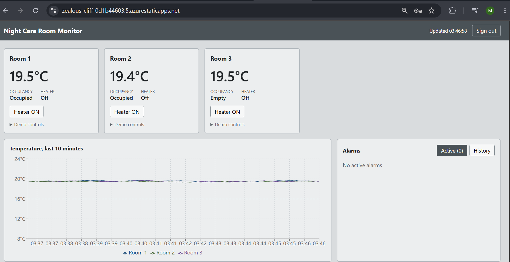
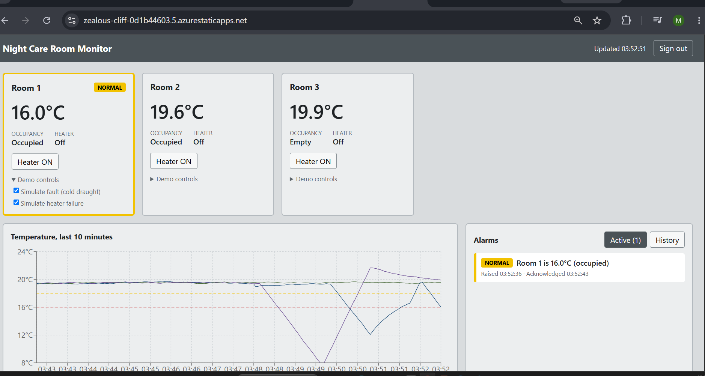
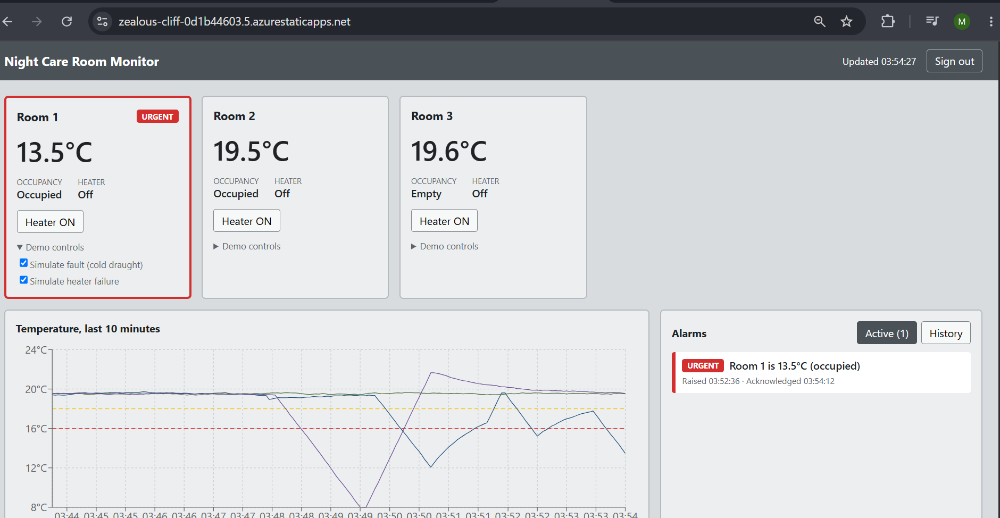
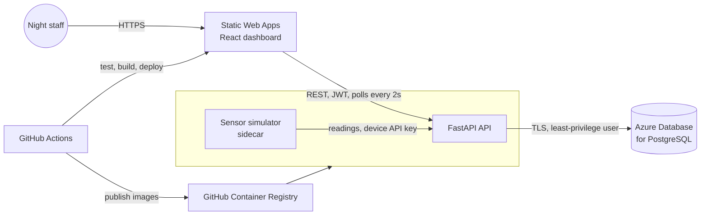
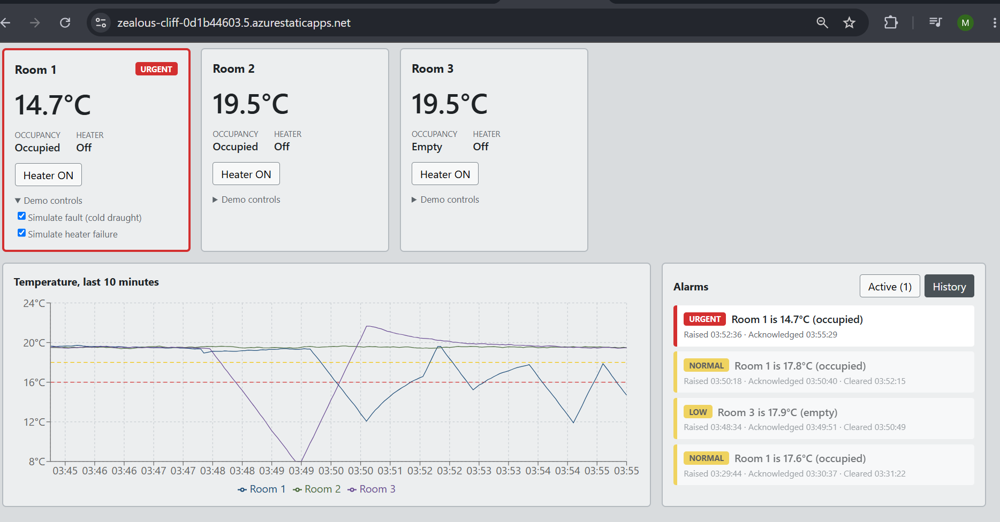

# Night Care Room Monitor

A web app that monitors room temperature and occupancy in supported living and alerts night staff only when action is needed.

**Live demo:** https://zealous-cliff-0d1b44603.5.azurestaticapps.net (demo login available on request)

## The problem

In supported living, one staff member covers the whole building at night from the staff room. Staff can't check room conditions without opening doors and waking residents, and vulnerable residents may not be able to say they are cold. If a room's temperature drops overnight, nobody knows.

This app shows every room's temperature at a glance and raises an alarm only when something needs attention, prioritised by whether someone is in the room.



## Features

- Live room status (temperature, occupancy, heater) with a 10 minute trend graph
- Alarm rules based on UKHSA guidance: below 18°C warning, below 16°C critical when occupied; an empty cold room is low priority
- 0.5°C clearing deadband to prevent alarm flooding
- Acknowledge alarms; unacknowledged alarms flash until seen
- Heater ON command sent back to the room
- Escalation: if the heater gives no 0.5°C rise within a set time, an "Equipment fault: escalate to on-call" alarm is raised
- Alarm history log with raised, acknowledged and cleared times
- Staff login
- Demo controls to simulate a cold draught or a heater failure

### Warning: an occupied room drops below 18°C



### Critical: an occupied room drops below 16°C



## Architecture



The simulator plays the role of field sensors, the API applies the alarm rules and stores history, and the dashboard is the operator screen, following the same pattern as a small SCADA/HMI system.

## Tech stack

| Area | Technology |
|---|---|
| Backend | Python 3.14, FastAPI, SQLAlchemy, Pydantic |
| Database | PostgreSQL 17 (Docker locally, Azure Database for PostgreSQL in the cloud) |
| Frontend | React, Vite, Recharts, plain CSS (ISA-101 style: grey screen, colour only for alarms) |
| Auth | JWT bearer tokens (8 hour shift), Argon2 password hashing, API key for devices |
| Containers | Docker, Docker Compose, multi-stage builds, non-root users |
| CI/CD | GitHub Actions, GitHub Container Registry |
| Cloud | Azure Container Apps, Azure Static Web Apps, Azure Database for PostgreSQL |
| Testing | pytest against a real PostgreSQL database |

## Security

- Passwords hashed with Argon2; tokens expire after one shift
- Separate API key for the sensor simulator, compared in constant time
- Input validation on every endpoint (Pydantic), unknown fields rejected
- Login lockout after 5 failed attempts in 5 minutes
- CORS restricted to the dashboard's origin
- Least-privilege database user (no DELETE, DROP or CREATE); a one-off init job uses admin rights
- Secrets in environment variables and Azure Container App secrets, never in Git
- HTTPS everywhere, TLS to the database, security headers on the dashboard
- £1 Azure budget alert; free tiers only

## Run it locally

Requirements: Docker Desktop.

```bash
git clone https://github.com/mahi7903/night-care-monitor.git
cd night-care-monitor
cp .env.example .env
```

Fill in `.env` (generate secrets with `python -c "import secrets; print(secrets.token_hex(24))"`), then:

```bash
docker compose up --build -d
```

Open http://localhost:8080 and sign in with `SEED_STAFF_USERNAME` and `SEED_STAFF_PASSWORD` from your `.env`.

### Run the tests

```bash
docker exec nightcare-db createdb -U nightcare_admin nightcare_test
cd backend
pip install -r requirements-dev.txt
python -m pytest -v
```

## CI/CD

Every push and pull request runs the backend tests (against a PostgreSQL service container) and the frontend build. On `main`, only after all checks pass, the pipeline publishes the API and simulator images to GitHub Container Registry and deploys the dashboard to Azure Static Web Apps.

## Alarm history



## Next steps

- Automate API deployment to Container Apps with OIDC from GitHub Actions
- Database migrations with Alembic
- Push updates with WebSockets instead of polling
- Shared rate-limit store (Redis) for multiple API instances
- Docker Hardened Images to reduce base image CVEs